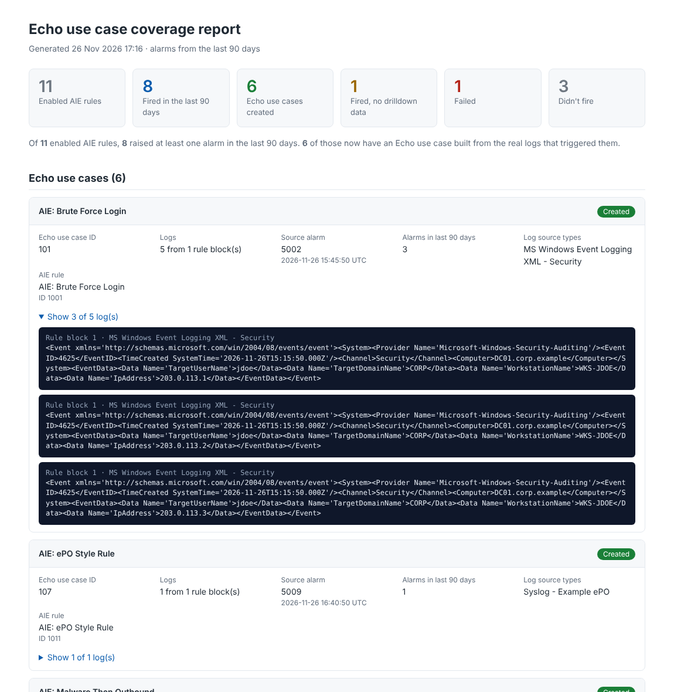

# LR-Echo-Coverage

**Turn the alarms your LogRhythm SIEM actually raised into replayable LogRhythm Echo use cases.**

You have a set of enabled AIE rules. This toolkit finds which of them fired in the last 90 days. For each one, it takes the real logs that triggered the alarm and creates an Echo use case named after that alarm. Then it gives you a report of exactly what was built.

> [!NOTE]
> Community tool. **Not an official LogRhythm or Exabeam product**, and not supported by them. LogRhythm, Echo and related names are trademarks of their respective owners. Parts of the Echo API it uses are undocumented, so try it in a lab first.



---

## How it works

```
Enabled AIE rules ─► Which fired? ─► Drilldown logs ─► .llx per rule ─► Echo use case ─► HTML report
```

1. **List the enabled AIE rules** from the EMDB (or a CSV).
2. **Find which fired** in the lookback period, using the LogRhythm Alarm API.
3. **Fetch the triggering logs** for the newest alarm of each rule, using the AIE Drilldown API.
4. **Package them as a `.llx`** (LogRhythm log export), keeping every log exactly as received.
5. **Create the Echo use case** through Echo's API, titled with the alarm name, with each log under its own log source type.
6. **Report** on every enabled rule: created, already in Echo, fired but no drilldown data, or didn't fire.

Nothing is changed in LogRhythm. Echo is the only place anything is created.

---

## Quick start

Requires Windows PowerShell 5.1 or PowerShell 7+. Nothing else to install.

The tool lives in `CustomIntegrations/EchoSyncTool` of the [LogRhythmToolchest](../../README.md) repository. Download it and open PowerShell in that folder:

```powershell
Invoke-WebRequest https://github.com/charliemacas/LogRhythmToolchest/archive/refs/heads/main.zip -OutFile LogRhythmToolchest.zip
Expand-Archive LogRhythmToolchest.zip C:\Tools
cd C:\Tools\LogRhythmToolchest-main\CustomIntegrations\EchoSyncTool
```

```powershell
# One-off, from the EchoSyncTool folder
Get-ChildItem -Recurse | Unblock-File
$env:LR_API_TOKEN = Read-Host 'LogRhythm API token'
```

**1. How many rules fired? (read-only)**

```powershell
.\Build-EchoCoverage.ps1 -SqlServer localhost -LrApiBaseUrl https://localhost:8501 `
    -LookbackDays 90 -StopAfter Alarms -SkipCertificateCheck
```

**2. Dry run on a couple of rules (builds everything, sends nothing to Echo)**

```powershell
.\Build-EchoCoverage.ps1 -SqlServer localhost -LrApiBaseUrl https://localhost:8501 `
    -EchoBaseUrl https://localhost:33333 -RuleFilter '*Brute*' -DryRun -SkipCertificateCheck
```

**3. Create the use cases**

```powershell
.\Build-EchoCoverage.ps1 -SqlServer localhost -LrApiBaseUrl https://localhost:8501 `
    -EchoBaseUrl https://localhost:33333 -LookbackDays 90 -SkipCertificateCheck
```

Results are written to `EchoCoverage_<date>_<time>\`. Open `coverage-report.html`.

Full instructions, every option and troubleshooting: **[docs/Build-EchoCoverage.md](docs/Build-EchoCoverage.md)**

---

## What you need

| | |
|---|---|
| **LogRhythm API token** | Issued by a Global Administrator from a third-party application in the Client Console |
| **Network access** | LogRhythm API gateway (usually port `8501`) and Echo (default port `33333`). Running on the Platform Manager / Echo host works well. |
| **EMDB read access** | To list the enabled AIE rules, or supply them as a CSV |
| **Auto Drilldown** | Enabled on the AIE rules you want covered. Only those alarms keep their triggering logs. |

---

## What's in this folder

| Path | What it is |
|---|---|
| [`Build-EchoCoverage.ps1`](Build-EchoCoverage.ps1) | The pipeline described above. Supports resume, dry run, rule filters, renamed rules and an optional anonymiser. |
| [`LLX-Tool.ps1`](LLX-Tool.ps1) | Standalone `.llx` reader/writer: view, export to text, compile from text or JSON, bulk convert. Safe on untrusted files. [Guide](docs/LLX-Tool.md) |
| [`Lab/`](Lab) | Two small scripts that prove the whole chain on a single alarm, one stage at a time. [Guide](docs/Build-EchoCoverage.md#quick-start-one-alarm-by-hand-lab-scripts) |
| [`docs/`](docs) | User guides, LLX file-format internals, API capture checklist |
| [`Examples/`](Examples) | Synthetic sample logs and example CSVs |
| [`Tests/`](Tests) | Self-tests, and simulated LogRhythm/Echo servers for contributors |
| [`HANDOVER.md`](HANDOVER.md) | Technical design, confirmed API formats and troubleshooting, for engineers and AI assistants |

### Working with `.llx` files on their own

```powershell
.\LLX-Tool.ps1 View    .\export.llx -ExpandEventXml        # see what's inside
.\LLX-Tool.ps1 Export  .\export.llx                        # -> export.txt
.\LLX-Tool.ps1 Compile .\logs.txt -TemplateLlx .\export.llx
.\LLX-Tool.ps1 BulkCompile .\folder-of-txt -OutputPath .\llx
```

---

## Status

- **Proven on a live LogRhythm 7.x + Echo system, one alarm end to end:** drilldown → `.llx` → Echo use case created through the API → replayed → the logs landed and parsed exactly like the originals.
- **The `.llx` files** are byte-identical to a genuine LogRhythm export.
- **The multi-rule pipeline** is covered by automated tests against simulated servers that reproduce the real API formats. For the first run on a new system, start with the read-only and dry-run steps above.

A replayed use case doesn't always re-trigger its alarm. For example, rules scoped to a specific log source won't match Echo's simulated sources. [Here's why](docs/Build-EchoCoverage.md#why-a-use-case-might-not-re-trigger-its-alarm).

---

## Contributing and data handling

Real SIEM logs contain usernames, hostnames and IP addresses, so:

- **Never commit run output.** That means the `EchoCoverage_*` and `LabPoc_*` folders, real `.llx` files, and `anonymisation-map.csv`. The included `.gitignore` excludes them.
- **Never paste real logs into issues.** Share field names and structure, or redacted samples.
- Everything in `Examples/` and `Tests/` is synthetic.

See [CONTRIBUTING.md](CONTRIBUTING.md), [SECURITY.md](SECURITY.md) and [CHANGELOG.md](CHANGELOG.md).

---

## Licence

*To be added.*
